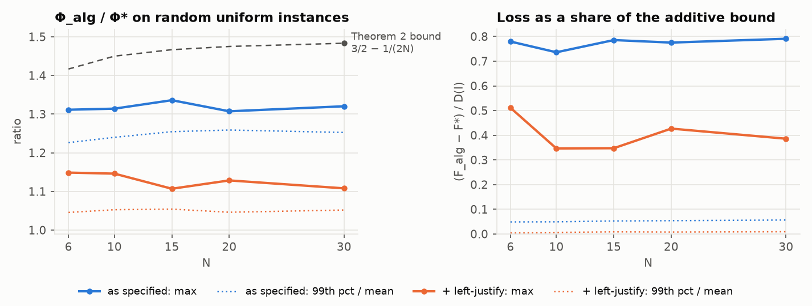

# pgt: phase-grid assignment for 1 | r_j, p_j = p | Σ w_j T_j

First implementation of the approximation algorithm of Chen & Hall, *Strong NP-Hardness
and Approximation Algorithm for Weighted Tardiness with Release Dates and Identical
Processing Times* ([arXiv 2609.28751](https://www.alphaxiv.org/abs/2609.28751)), with two
exact oracles and an empirical study of how far the algorithm is from the optimum.
Findings are in [REPORT.md](REPORT.md).

## The algorithm

Single machine, N jobs with release r_j, due date d_j, weight w_j and a common processing
time p. For each distinct release residue a ∈ {r_j mod p}:

1. round every release up to the grid a + pℤ: R_j(a) = a + p⌈(r_j − a)/p⌉;
2. offer the slots T_a = {R_i(a) + kp : i ≤ N, 0 ≤ k < N};
3. solve a rectangular min-cost assignment of jobs to slots (edge iff t ≥ r_j, cost
   w_j (t + p − d_j)⁺) with `scipy.optimize.linear_sum_assignment`.

Slots on one grid never overlap, so each assignment is a schedule, and it is optimal among
schedules on that grid. The best phase satisfies Φ_alg/Φ* ≤ 3/2 − Σw_j²/(2W²) for the
shifted objective Φ = F + pW (Theorem 2). An optional post-pass keeps the job order and
starts every job as early as possible ("left-justify"); it never hurts.

Two additions beyond the paper, kept out of the algorithm's own code path:

- **A lower bound.** Rounding releases *down* to a grid instead of up turns the same
  assignment into a relaxation: LB = max over release residues of the round-down
  assignment cost satisfies LB ≤ F*, so F_alg − LB certifies the loss a posteriori without
  an exact solver. Residues that no release uses never help (they are dominated by the next
  release residue), so the release residues already give the strongest bound.
- **A local search.** `solve_plus` starts from the best of the left-justified order of every
  phase and ATC and applies first-improvement swap and insertion moves on the job order.
  Its output is never worse than the left-justified algorithm, so Theorem 2 still holds
  for it. See [REPORT.md, Section 5](REPORT.md#5-a-lower-bound-and-a-local-search).

## Install and use

```bash
uv sync
```

```bash
uv run pgt gen uniform --n 20 --p 20 -o inst.json
```

```bash
uv run pgt solve inst.json --left-justify --exact
```

```bash
uv run pgt solve inst.json --plus
```

`--plus` also runs `solve_plus` and prints `F_plus`, the lower bound `LB` and the certified
gaps `F_plus − LB` and `F_alg − LB`. `pgt bench` times the algorithm, `pgt verify --count
500` cross-checks both exact oracles and Theorem 2 on random small instances. Instances
are JSON: `{"p": 3, "r": [...], "d": [...], "w": [...]}`.

```python
from pgt import Instance, solve, solve_plus, lower_bound, exact

inst = Instance(p=3, r=[0, 1, 7], d=[3, 4, 9], w=[1, 2, 5])
res = solve(inst, left_justify=True)
res.F_alg, res.F_lj, res.schedule.starts, res.per_phase
lower_bound(inst)  # <= F*; lower_bound(inst, range(inst.p)) inspects every residue
plus = solve_plus(inst)
plus.F_plus, plus.lower_bound, plus.gap, plus.lb.per_phase  # F* <= F_plus <= F_lj <= F_alg
exact.milp(inst, time_limit=60, warm_start=plus.schedule).F
```

## Layout

| module | contents |
|---|---|
| `pgt.instance` | `Instance` (validated int64 arrays, JSON I/O) and generators |
| `pgt.schedule` | `Schedule` (feasibility, F, Φ), `left_justify(inst, order)` |
| `pgt.phase_grid` | the algorithm: `residues`, `round_up`, `slots`, `solve_phase`, `solve` |
| `pgt.exact` | `brute_force` (all N! orders, N ≤ 10), `milp` (time-indexed MIP, HiGHS) |
| `pgt.heuristics` | non-delay WSPT, EDD and ATC dispatch rules for comparison |
| `pgt.bounds` | D(I), the ratio bound, exact `Fraction` bound checks |
| `pgt.lower_bound` | `round_down`, `lower_bound(inst, phases=None)`, per-phase `lower_bound_detail`, `certified_gap` |
| `pgt.local_search` | `local_search(inst, order)` (swap + insertion descent), `solve_plus(inst)` → `PlusResult` |

All objective arithmetic is exact: costs are integers, and both the assignment and the MIP
refuse instances whose costs would not be exactly representable in float64.

## Tests

```bash
uv run pytest
```

The suite covers the Proposition 3 tight family for N = 1..12 (ratio exactly
3/2 − 1/(2N), loss gone after left-justify), Lemma 6 (each phase equals a brute force over
grid schedules), exactness for a single release residue, the Theorem 2 bounds against brute
force, agreement of both oracles on 500 instances, Hypothesis property tests, and edge cases
(N = 1, p = 1, duplicate jobs, unavoidable tardiness, weights near the int64 limit). For the
additions: LB ≤ F* against brute force, each phase bound against a brute force over
rounded-down grid schedules, LB = F* for one residue, monotonicity in the phase set,
F* ≤ F_plus ≤ F_lj ≤ F_alg, and local optimality of the search's output.

## Reproducing the experiments

```bash
uv run python experiments/run_ratio_study.py
```

```bash
uv run python experiments/run_runtime_study.py alg
```

```bash
uv run python experiments/run_runtime_study.py mip
```

```bash
uv run python experiments/run_bounds_study.py
```

```bash
uv run python experiments/plots.py
```

The runners use all but one CPU thread at lowered priority, run HiGHS single-threaded per
process, and append to `experiments/results/*.csv` as they go, so an interrupted run
resumes where it stopped. Every CSV row has a `key` that rebuilds its instance:
`uv run python experiments/generate.py --show '<key>'`. The bounds study writes
`experiments/results/bounds_<family>.csv` with the lower bound and local-search columns
for the same keys, copying `F_opt` from the ratio study when it exists.



## License

MIT, see [LICENSE](LICENSE).
