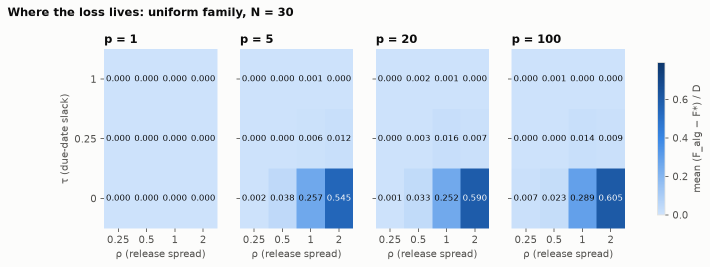
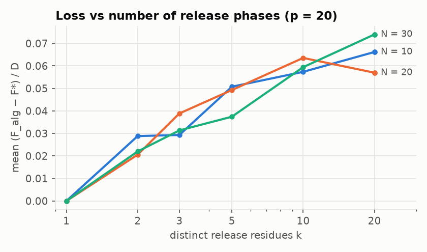
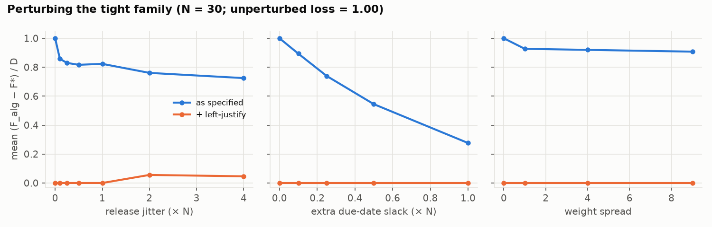
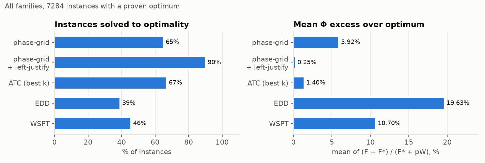
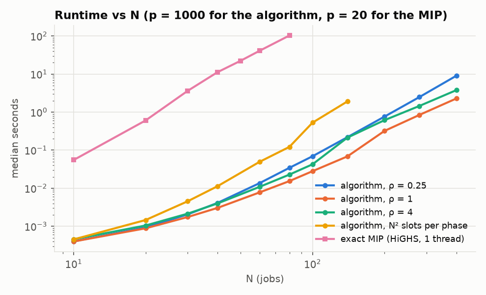

# How the phase-grid algorithm behaves against the exact optimum

Empirical study of the approximation algorithm of Chen & Hall
([arXiv 2609.28751](https://www.alphaxiv.org/abs/2609.28751)) for
1 | r_j, p_j = p | Σ w_j T_j. The paper ships no code or computational results; everything
below comes from this repository and can be regenerated with the commands in the
[README](README.md#reproducing-the-experiments).

## Summary

- **The guarantee held everywhere.** 7,284 instances (N = 6 to 30), every one solved to
  proven optimality, without a single violation of either the ratio bound or the additive
  bound F_alg ≤ F* + D(I).
- **In practice the ratio sits far below 3/2.** On random uniform instances the mean
  Φ_alg/Φ* is 1.017, the 99th percentile about 1.25 and the worst case 1.34, while the
  bound is 1.42 to 1.48 for these N. The additive bound is less loose: the worst random
  instance loses 79% of D(I), the mean is 5%.
- **The loss comes from one regime:** releases spread out (ρ ≥ 1) and tight due dates
  (τ = 0), i.e. jobs that barely interact and have no slack to absorb the rounding of
  their release onto a foreign grid. That is the tight family of Proposition 3 in random
  form. With p = 1, or with a single release residue, the algorithm is exact, as the paper
  says.
- **Left-justification removes most of the gap but not all of it.** It cuts the mean loss
  about 7× (5.2% → 0.7% of D) and reaches the optimum on 91% of uniform instances, versus
  77% without it. The worst case is still 35 to 51% of D at every N, and the hit rate
  falls with N (96% at N = 6, 85% at N = 30). On the tight family it is exact, as
  Section 6.4 notes, until releases are jittered enough for jobs to interact.
- **A free improvement:** left-justifying every phase's schedule and keeping the best
  (instead of only the winning phase's) reaches the optimum on 94% of all instances, and
  its worst ratio is 1.09 instead of 1.15.
- **Against dispatch rules:** as specified, the algorithm is about as good as a tuned ATC
  rule on average (1.7% vs 1.7% mean Φ excess on uniform instances) but has a much better
  worst case (1.34 vs 1.42). With left-justification it beats ATC on 29% of instances and
  loses on 3%. EDD and WSPT are far behind.

## Setup

**Objective.** F = Σ w_j T_j. The guarantee is stated for Φ = F + pW, W = Σ w_j. Ratios
below are Φ_alg/Φ*; "loss" is (F_alg − F*)/D(I) with D(I) = p(W² − Σ w_j²)/(2W), the
additive slack of Theorem 2, so loss lies in [0, 1] whenever the theorem holds.

**Variants.**

| name | what it is |
|---|---|
| as specified | Section 6.2: best phase of the per-phase assignments |
| + left-justify | the winning phase's job order, every job started as early as possible (6.4) |
| left-justify all phases | the same post-pass applied to every phase's schedule, best kept |
| ATC (best k) | non-delay apparent tardiness cost, best look-ahead k ∈ {0.5, 1, 2, 3, 4} |
| EDD, WSPT | non-delay earliest due date, largest weight first (equal p) |

**Exact optimum.** A time-indexed MIP over the start set {r_i + kp : k < N}, which
contains every left-justified start, solved by HiGHS 1.15 single-threaded with a 300 s
limit and warm-started from the best heuristic schedule. A permutation brute force agrees
with it on 500 random instances in the test suite and 1,000 more in `pgt verify`. Every one
of the 7,284 study instances was closed to optimality (median 0.06 s, slowest 40 s).

**Instance families** (`experiments/generate.py`; 20 seeds per cell):

| family | parameters | instances |
|---|---|---|
| uniform | r ~ U[0, ρNp], d = r + p + U[0, τNp], w ~ U[1, 10]; N ∈ {6, 10, 15, 20, 30}, p ∈ {1, 5, 20, 100}, ρ ∈ {0.25, 0.5, 1, 2}, τ ∈ {0, 0.25, 1} | 4,800 |
| tight | Proposition 3 (p = N, r_i = i(2N+1), d_i = r_i + N, w = 1) with one knob turned: release jitter U[±jN], extra due slack U[0, sN] or weights U[1, 1+ws]; N ∈ {6, 10, 20, 30} | 1,044 |
| few_phase | uniform-like, p = 20, releases on only k residues, k ∈ {1, 2, 3, 5, 10, 20}; N ∈ {10, 20, 30} | 1,440 |

Raw results: `experiments/results/ratio_*.csv`, one row per instance (its `key` rebuilds
the instance).

## 1. How far below the bound?

Uniform family, all 960 instances per N:

| N | bound 3/2 − 1/(2N) | max ratio | 99th pct | mean | max loss | mean loss | optimal |
|---|---|---|---|---|---|---|---|
| 6 | 1.417 | 1.311 | 1.226 | 1.016 | 0.78 | 0.049 | 80% |
| 10 | 1.450 | 1.314 | 1.240 | 1.017 | 0.74 | 0.049 | 77% |
| 15 | 1.467 | 1.336 | 1.255 | 1.018 | 0.79 | 0.053 | 77% |
| 20 | 1.475 | 1.307 | 1.259 | 1.018 | 0.78 | 0.054 | 76% |
| 30 | 1.483 | 1.320 | 1.253 | 1.018 | 0.79 | 0.057 | 76% |

None of these numbers depends much on N. The ratio stays well under the bound because
the bound is attained only when F* = 0 *and* the loss equals D(I); on random instances
the worst losses come with F* > 0, which dilutes the ratio. Measured against D(I) instead,
the worst random case comes within about 20% of the additive bound. So the analysis is
not loose in the worst case, only on average.

The unperturbed tight family reproduces Proposition 3 exactly: every phase loses
N(N−1)/2, the ratio equals 3/2 − 1/(2N) (1.483 at N = 30) and loss = 1.

### Where the loss lives

Mean loss on the uniform family by knob (all N):

| knob | value | mean loss | max loss | optimal | optimal after left-justify |
|---|---|---|---|---|---|
| p | 1 | 0 | 0 | 100% | 100% |
| | 5 | 0.065 | 0.75 | 72% | 88% |
| | 20 | 0.070 | 0.79 | 70% | 87% |
| | 100 | 0.074 | 0.79 | 68% | 88% |
| ρ (release spread) | 0.25 | 0.001 | 0.16 | 97% | 99% |
| | 0.5 | 0.009 | 0.34 | 88% | 97% |
| | 1 | 0.064 | 0.71 | 65% | 82% |
| | 2 | 0.136 | 0.79 | 60% | 85% |
| τ (due slack) | 0 | 0.146 | 0.79 | 56% | 80% |
| | 0.25 | 0.011 | 0.35 | 79% | 93% |
| | 1 | 0.001 | 0.11 | 97% | 99% |

- **Congestion helps the algorithm.** When releases are packed (ρ ≤ 0.5) the machine is
  busy from the first release onward, so a good schedule is mostly one block on the first
  release's grid, and that grid is one of the phases.
- **Slack hides the rounding.** Moving a job's start up to p − 1 later costs nothing when
  its due date has room, so τ ≥ 0.25 makes the loss negligible.
- **p matters only through the number of residues.** p = 1 has one phase and is exact.
  From p = 5 upwards there are already several residues and the loss is about the same.

### Number of release phases

| residues k | 1 | 2 | 3 | 5 | 10 | 20 |
|---|---|---|---|---|---|---|
| mean loss | 0 | 0.024 | 0.033 | 0.046 | 0.060 | 0.066 |
| max loss | 0 | 0.41 | 0.43 | 0.54 | 0.56 | 0.50 |
| optimal | 100% | 75% | 68% | 66% | 62% | 58% |

The mean loss grows steadily with the number of residues, which supports the paper's
suggestion that the number of release phases governs the difficulty. The worst case does
not show the same gradient, though: with only two residues the loss already reaches 41%
of D(I). On this evidence, a sharper guarantee for few phases would have to depend on more
than k alone, for instance on how the weight is split between the phases.

## 2. Does left-justification make the gap vanish?

**On the tight family, yes, but only while jobs stay isolated.** Left-justify returns the
optimum on all 884 tight instances with release jitter below 2N: the unperturbed
instance, every due-date slack level, every weight spread and jitter up to N. From a
jitter of 2N, neighbouring jobs compete for the machine. The post-pass then finds the
optimum on 85 to 90% of the N = 6 instances but only 20 to 25% of the N = 30 ones, though
it still recovers 93 to 96% of the loss at every N.

**On random data, no.** It removes most of the loss but leaves a hard core:

| N | mean loss | after left-justify | max loss after | optimal | after left-justify | left-justify all phases |
|---|---|---|---|---|---|---|
| 6 | 0.049 | 0.0046 | 0.51 | 80% | 96% | 99.5% |
| 10 | 0.049 | 0.0063 | 0.35 | 77% | 94% | 98.1% |
| 15 | 0.053 | 0.0086 | 0.35 | 77% | 89% | 95.2% |
| 20 | 0.054 | 0.0078 | 0.43 | 76% | 89% | 94.4% |
| 30 | 0.057 | 0.0091 | 0.39 | 76% | 85% | 90.5% |

(uniform family; "after left-justify" = winning phase's order left-justified.)

Left-justifying can only remove idle time. It cannot repair the *order*. The winning
phase's order is optimal for releases rounded up to that phase's grid, and when those
roundings change which job is ready first, the order is wrong for the true releases. The
instance with the largest remaining loss,
`uniform(n=6,p=5,rho=1.0,tau=0.0)#10` (r = 25, 4, 23, 29, 29, 0), has F* = 71 and
F_alg = F_lj = 109. Left-justifying does not change the winning phase's objective at all.
Left-justifying another phase's order gives 71, and so does ATC. Because more jobs mean
more chances for such a swap, the hit rate falls as N grows.

Trying every phase's order costs N extra left-justify passes of O(N) each, which is
negligible next to the assignments. It raises the hit rate by 3 to 6 points and cuts the
remaining worst case from 1.15 to 1.09 (over all 7,284 instances).

## 3. Against dispatch rules

| method | optimal (all) | mean Φ excess (uniform) | worst Φ ratio (all) |
|---|---|---|---|
| phase-grid, as specified | 65% | 1.74% | 1.483 |
| phase-grid + left-justify | 90% | 0.22% | 1.149 |
| left-justify all phases | 94% | 0.06% | 1.087 |
| ATC (best of 5 k) | 67% | 1.67% | 1.417 |
| EDD | 39% | 19.2% | 2.461 |
| WSPT | 46% | 14.1% | 3.607 |

The algorithm's guarantee is what separates it from ATC in the worst case. ATC has no
bound and reaches 1.42 on uniform instances. The tight family is an exception the other
way: with isolated jobs every non-delay rule is optimal there, which is exactly where the
unmodified algorithm is at its worst. Taking the better of left-justify and ATC is optimal
on 92% of all instances.

## 4. Runtime

Single process, one thread, AMD Ryzen 5 5600X, median of 5 instances per point
(`experiments/results/runtime_*.csv`). The algorithm uses p = 1000 so nearly every job has
its own residue (N phases); the MIP uses the study's p = 20.

| N | phases | slots per phase (ρ = 1) | algorithm, ρ = 1 | algorithm, N² slots | exact MIP |
|---|---|---|---|---|---|
| 10 | 10 | 18 | 0.4 ms | 0.5 ms | 0.04 s |
| 20 | 20 | 37 | 0.9 ms | 1.5 ms | 0.6 s |
| 40 | 39 | 78 | 3.0 ms | 11 ms | 11 s |
| 80 | 75 | 158 | 15 ms | 0.12 s | 103 s |
| 140 | 129 | 278 | 69 ms | 1.9 s | |
| 400 | 325 | 799 | 2.3 s | | |

- **The O(N⁵) bound is pessimistic.** Phase a offers |T_a| ≤ min(N², (max R − min R)/p + N)
  distinct slots, because the windows R_i(a) + {0, …, N−1}p of different jobs overlap on
  the same grid. On every random family that is a small multiple of N (about (1 + ρ)N),
  not N², so a phase is an N × O(N) assignment. Fitted exponents for N ≥ 40: 3.0
  (ρ = 1), 3.1 (ρ = 4), 3.4 (ρ = 0.25; congestion makes the shortest augmenting paths
  longer even though there are fewer slots). Only the artificial "spread" family, with
  releases N·p apart, forces N² slots per phase, and it grows as N^4.2.
- **N = 400 takes about 2 to 9 seconds**, far beyond the plan's target of 60 to 80. In
  the N² worst case the dense cost matrices hold N³ entries per phase (two copies of
  64 M entries, about 1 GB, at N = 400), so there memory becomes the limit before time.
- **The exact MIP grows as about N^3.4 and is 3 to 4 orders of magnitude slower.** It
  still closed every instance up to N = 80 (about 150,000 binaries) in at most 126 s,
  which suggests the time-indexed relaxation is tight on this generator. So for N ≤ 80 and this generator, an exact solution is practical, and the
  case for the algorithm rests on its guarantee and its speed, not on exact methods
  being out of reach.

## Reproducibility and checks

- `uv run pytest` (52 tests, about 10 s) covers the Proposition 3 family for N = 1..12,
  Lemma 6 against a brute force over grid schedules, exactness for one residue, Theorem 2
  against brute force on 600 instances, oracle agreement on 500 instances, Hypothesis
  property tests, and edge cases.
- All objective arithmetic is integer. The assignment and the MIP use float64 costs, so
  both refuse instances where N × (largest cost) ≥ 2^53, which keeps every partial sum
  exact.
- Deviations from PLAN.md: the MIP oracle uses `highspy` (the same HiGHS solver that
  `scipy.optimize.milp` wraps) because SciPy exposes neither the thread count nor warm
  starts. Running 12 SciPy MIPs in parallel oversubscribed the CPU about 12× and turned
  0.5 s solves into 40 s. The study also adds the "left-justify all phases" variant and
  a "spread" runtime family that forces N² slots per phase.
